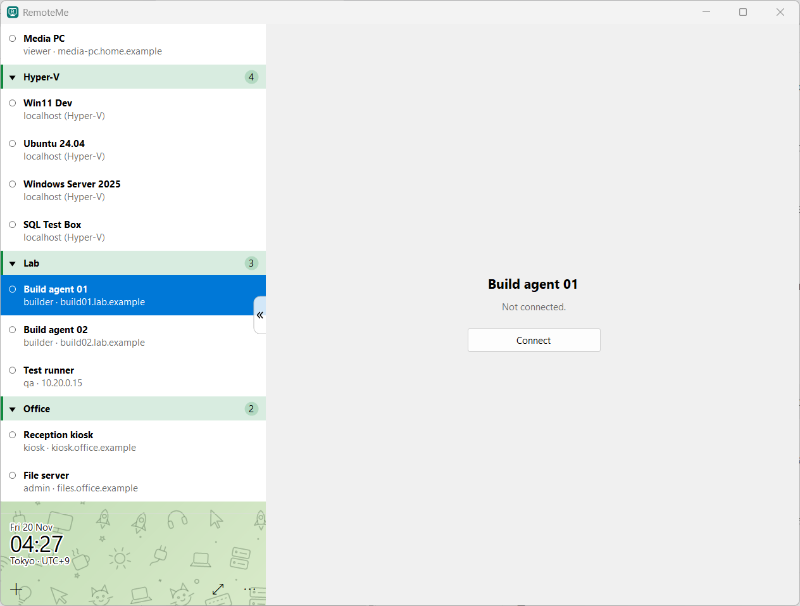
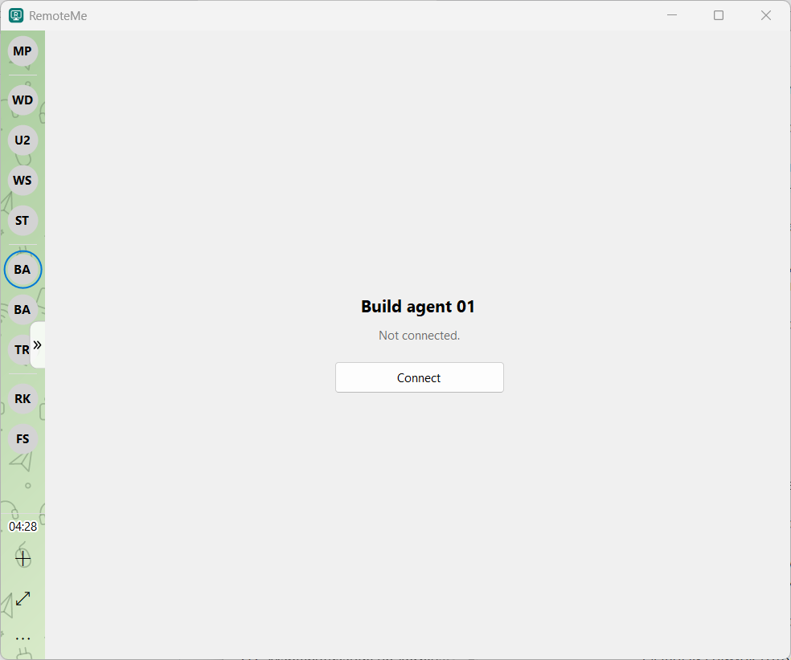
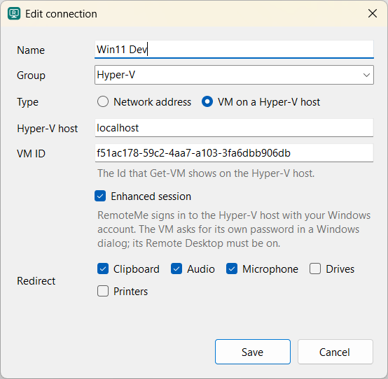

# RemoteMe

RemoteMe is a Remote Desktop client for Windows 10 and Windows 11. It is built on the Remote Desktop
component that ships with Windows (`mstscax.dll`). The remote desktop follows the size of the window and
the scale of the monitor, so the picture stays sharp, and the window holds only the list of connections
and the session itself.

- One portable exe: nothing to install, and the settings file and the log are kept next to it.
- Connections and their passwords are kept in one file, encrypted with a master password.
- A session can be moved to a separate window or shown full screen on any monitor.
- A virtual machine on the Hyper-V host of this computer opens directly, without network access inside
  the VM.

The list can be narrowed to a strip of circles:

A connection to a VM on the Hyper-V host of this computer:

