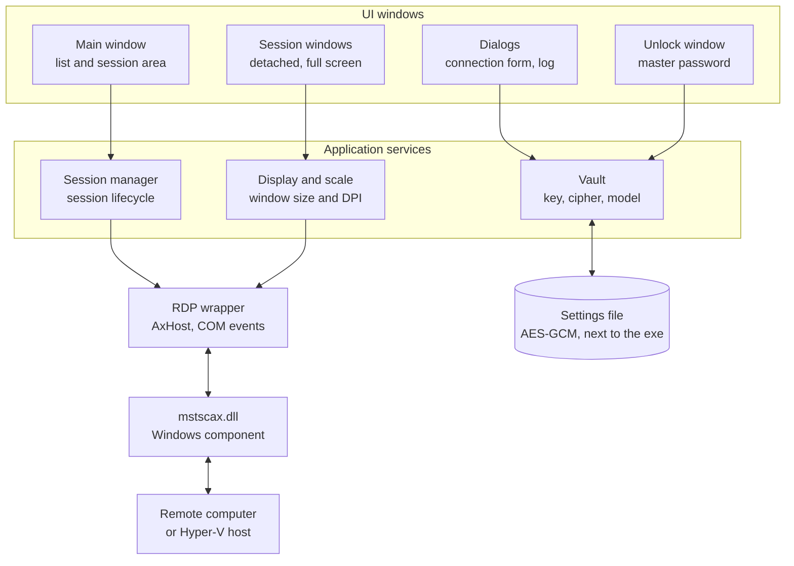

# RemoteMe architecture

Design as of 2026-11-13. Requirements and interface decisions are in the
[README](../README.md); this document describes how the application is split into parts.

## Components

Dependencies go only from top to bottom: windows know about services, services do not know about
windows. COM lives only in the RDP wrapper. Cryptography and file access live only in the vault.

## Data flows

1. **Unlock.** The unlock window passes the password to the vault. The vault reads the file header
   (version, salt, iteration count, key check, revision, nonce), derives 64 bytes with PBKDF2, compares
   the key check, decrypts with AES-GCM, parses the JSON and gives the connection model to the main
   window. The key check (an HMAC made with the second half of the derived bytes) tells a wrong
   password apart from a damaged file; the AES-GCM tag, which also covers the header, catches damage
   and tampering. The layout is described in `src/RemoteMe.Core/Vault/VaultHeader.cs`.
2. **Save.** Check that the file on disk is still the one the vault read or wrote last (otherwise a
   conflict is reported and nothing is written), model to JSON, encryption with a new nonce and the
   next revision, write to a temporary file, atomic replace of the main file. Connection passwords are
   kept in memory as `ProtectedSecret` (encrypted with a per-process key) and go into and out of the
   JSON without plain-text strings; plain-text buffers are zeroed.
3. **Connect.** A click in the list makes the session manager create a session and take the address,
   user name and password from the model. The RDP wrapper sets the properties and calls `Connect`. The
   component raises events (connection progress, logon, disconnect with a reason code). They change
   the session state, which updates the status dot in the list, the text in the session area and the
   log.
4. **Size and scale.** A window reports the end of a resize, a move to another monitor, a DPI change or
   a switch to full screen. The display service calculates the size and the scale. The RDP wrapper
   calls `UpdateSessionDisplaySettings`.
5. **Detach and full screen.** The session manager moves the session host between the main window and
   a separate window.

## Projects and modules

Three projects, and the output is still one exe: `RemoteMe.Core` (no UI, covered by tests), `RemoteMe`
(WinForms and COM), `RemoteMe.Tests`.

Layout: `RemoteMe.slnx` in the root; `src/RemoteMe.Core` (`net10.0`), `src/RemoteMe` (`net10.0-windows`),
`tests/RemoteMe.Tests` (xUnit v3). Shared build settings are in `Directory.Build.props`, code style in
`.editorconfig`, the single-file publish profile in `src/RemoteMe/Properties/PublishProfiles/SingleFile.pubxml`.

| Module | Project | Responsibility |
|---|---|---|
| Vault | Core | File format, key derivation, encryption, atomic write, master password change |
| Model | Core | Connections, groups, settings; schema version and migrations; `System.Text.Json` with source generation |
| Sessions | Core | Session manager, states (disconnected, connecting, connected, reconnecting, failed), disconnect reason texts, reconnect on connection loss |
| Log | Core | In-memory log with a size limit |
| RdpInterop | RemoteMe | Class derived from `AxHost`, hand-declared COM interfaces, event sink |
| Display | RemoteMe | Size and scale calculation, delay for a series of changes, monitor detection |
| UI | RemoteMe | Unlock window, main window (list, session area), session window, connection form, log window |
| Input | RemoteMe | Hotkeys while the focus is inside the remote desktop |
| App | RemoteMe | Entry point, manual wiring of dependencies, single instance, unhandled error handling |
| Build | - | Single-file publish profile, build and tests in GitHub Actions |

## Platform conventions

- .NET 10 (LTS), C# 14, nullable enabled, warnings as errors.
- `ApplicationHighDpiMode = PerMonitorV2` in the project file.
- `Rfc2898DeriveBytes.Pbkdf2` (SHA-256, at least 600,000 iterations as OWASP recommends), `AesGcm`,
  `CryptographicOperations.ZeroMemory`.
- No trimming and no Native AOT: WinForms and built-in COM interop are not compatible with them.
- No third-party packages in the application itself.

## Technical risks

| Risk | What to do |
|---|---|
| The RDP component may not survive a move between windows | Checked in stage 1: it survives a move with the WinForms `Parent` property, no reconnect |
| The component captures keys inside the session | Its input window runs on its own thread, so the message loop never sees session keys; hotkeys need a low-level keyboard hook (remaining checks in the README) |
| All sessions run on one UI thread (an ActiveX requirement) | Accept for the first version; if it becomes a problem, one process per session |
| A series of resize events | Send only the final size; the width must be even, from 200 to 8192 |
| Scale change on the fly inside the guest Windows | Checked in stage 1: `UpdateSessionDisplaySettings` applies a new scale without a reconnect |
| Single-file may extract libraries to a temporary folder | Check during the build, this affects the portable requirement |
| The settings file is edited on two machines | Single instance, atomic write, a version counter inside the file |
| Direct Hyper-V connection is not verified | Prototype: port, VM ID, rights on the host, credentials for the host and the guest |

## Security risks

| Risk | What to do |
|---|---|
| Master password guessing on a copied file | Expensive key derivation, a warning for a password shorter than 12 characters (no hard minimum, by the owner's decision), parameters in the header so they can be raised later |
| A replaced or rolled back file (for example, a lowered iteration count) | The header is part of the data authenticated by AES-GCM; limits on accepted parameters |
| Passwords in process memory (.NET strings cannot be zeroed, dumps, page file) | Keep connection passwords encrypted and decrypt them only at connect time; zero the buffers; never write secrets to the log or to error messages |
| An unlocked application left unattended | Accepted: there is no auto-lock (requirement 10) |
| Untrusted server certificate, man-in-the-middle attack | Require NLA; warn on the first connection and remember the consent (requirement 12) |
| RDP bitmap cache on disk and traces in the registry | Turn off the persistent cache; describe the registry traces in the README |
| Clipboard and drives shared between sessions of different clients | Redirection is set per connection, drives are off by default (requirement 13) |
| A replaced unsigned exe in a synced folder | Checksum in releases; code signing if possible |
| Public repository | No real addresses or user names in tests and screenshots |
